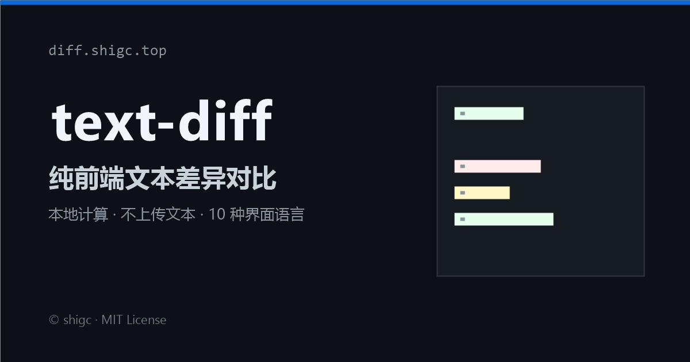

# text-diff · Textvergleich online

[简体中文](./README.md) · [English](./README.en.md) · [繁體中文](./README.zh-TW.md) · [日本語](./README.ja.md) · [한국어](./README.ko.md) · [Español](./README.es.md) · [Français](./README.fr.md) · **Deutsch** · [Русский](./README.ru.md) · [Português](./README.pt.md)

[](https://github.com/shigc/text-diff/actions/workflows/ci.yml)
[](./LICENSE)
[](https://diff.shigc.top/)

Ein **vollständig clientseitiges** Textvergleichswerkzeug nach dem Vorbild von Beyond Compare. Die gesamte Berechnung findet im Browser statt und **Texte werden niemals an einen Server gesendet** – du kannst also bedenkenlos Konfigurationen, Logs oder Verträge einfügen.



## Online nutzen

<https://diff.shigc.top/>

Keine Installation, keine Anmeldung – einfach öffnen und loslegen.

## Funktionen

- **Zwei Ansichten**: nebeneinander (split) und vereinheitlicht (unified), mit Hervorhebung auf Zeichenebene
- **Diff-Navigation**: zum vorherigen / nächsten Unterschied springen, mit Live-Zählung hinzugefügter, entfernter und geänderter Zeilen
- **Vergleichsoptionen**: Leerzeichen ignorieren, Groß-/Kleinschreibung ignorieren, Leerzeichen sichtbar machen
- **Flexible Eingabe**: einfügen, Datei auswählen oder per Drag & Drop in den Editor ziehen
- **Export mit einem Klick**: HTML-Bericht / PDF / CSV
- **Mehrsprachige Oberfläche**: Chinesisch (vereinfacht/traditionell), Englisch, Japanisch, Koreanisch, Spanisch, Französisch, Deutsch, Russisch, Portugiesisch – sofortiger Wechsel, Auswahl wird gespeichert
- **Minimale Abhängigkeiten**: einzige Laufzeitabhängigkeit ist [jsdiff](https://github.com/kpdecker/jsdiff); das Build-Ergebnis besteht aus rein statischen Dateien

## Lokale Entwicklung

Erfordert Node.js 18 oder neuer.

```bash
npm install
npm run dev        # Entwicklungsserver, standardmäßig http://localhost:5173
```

Häufige Befehle:

```bash
npm run build            # strenge Typprüfung mit tsc + Produktions-Build
npm run preview          # Build lokal ansehen
npm run typecheck        # nur Typprüfung
npm run lint             # ESLint
npm run format           # Formatierung mit Prettier
npm run build:obfuscated # Build mit JS-Verschleierung (standardmäßig aus)
```

Produktions-Builds werden standardmäßig **nicht** verschleiert, damit das Ergebnis lesbar und prüfbar bleibt. Wer beim Deployment verschleiern möchte, setzt `OBFUSCATE=1` oder führt `npm run build:obfuscated` aus.

## Auf Cloudflare Pages bereitstellen

### Variante 1: Git-Integration (empfohlen)

Verbinde dieses Repository in Cloudflare Pages mit folgender Konfiguration:

| Einstellung      | Wert            |
| ---------------- | --------------- |
| Framework        | Keins (None)    |
| Build command    | `npm run build` |
| Output directory | `dist`          |
| Node version     | 20              |

Jeder Push auf `main` wird automatisch bereitgestellt. `public/_headers` wird wirksam und ergänzt CSP sowie weitere Sicherheits-Header.

### Variante 2: Kommandozeile

```bash
npx wrangler login   # Browser-Autorisierung oder API-Token verwenden
npm run deploy       # Build + Deployment
```

Für ein API-Token `.env.example` nach `.env` kopieren und ausfüllen:

```dotenv
CLOUDFLARE_API_TOKEN=dein-api-token
CLOUDFLARE_ACCOUNT_ID=deine-konto-id
CF_PAGES_PROJECT=text-diff
CF_PAGES_BRANCH=main
```

`npm run deploy` liest `CF_PAGES_PROJECT` / `CF_PAGES_BRANCH` aus `.env`; nach einem Fork muss also nur der Projektname geändert werden. `.env` ist in `.gitignore` eingetragen und wird nie committet.

## Projektstruktur

```text
.
├─ index.html            Grundgerüst der Single Page (inkl. SEO / OG)
├─ public/               robots.txt, sitemap.xml, _headers, Social-Preview-Bild
├─ scripts/              plattformübergreifende Build- und Deploy-Skripte
├─ src/
│  ├─ main.ts            Einstiegspunkt: Status, Rendering und Interaktion
│  ├─ state.ts           globaler Zustand
│  ├─ styles.css         alle Styles
│  ├─ diff/              Diff-Berechnung und Typen (jsdiff-Wrapper)
│  ├─ export/            Export nach HTML / PDF / CSV
│  ├─ i18n/              i18n-Framework und 10 Sprachen
│  └─ ui/                Eingabe, Rendering, Navigation, Sprachwechsel
└─ .github/              CI, Dependabot, Issue- / PR-Vorlagen
```

## Datenschutz

- Die gesamte Textverarbeitung erfolgt im Browser-Tab; es gibt keinen Upload-Endpunkt
- Keine Analyse-, Tracking-, Werbe- oder Fehlerberichts-Skripte; die Seite lädt keine Ressourcen von Drittanbietern
- `localStorage` speichert ausschließlich die Spracheinstellung
- Exportierte Dateien entstehen lokal und werden erst beim Klick auf „Herunterladen“ gespeichert

## Browser-Unterstützung

Nur moderne Browser (jeweils die letzten beiden Hauptversionen von Chrome / Edge / Firefox / Safari). Build-Ziel ist ES2020; IE wird nicht unterstützt.

## Mitwirken

Issues und PRs sind willkommen. Bitte lies zuerst [CONTRIBUTING.md](./CONTRIBUTING.md) und [CODE_OF_CONDUCT.md](./CODE_OF_CONDUCT.md). Sicherheitsprobleme bitte gemäß [SECURITY.md](./SECURITY.md) vertraulich melden.

## Danksagung

Der Diff-Algorithmus stammt von [jsdiff](https://github.com/kpdecker/jsdiff) (MIT); Bedienung und Gestaltung orientieren sich an [Beyond Compare](https://www.scootersoftware.com/).

## License

[MIT](./LICENSE) © shigc
